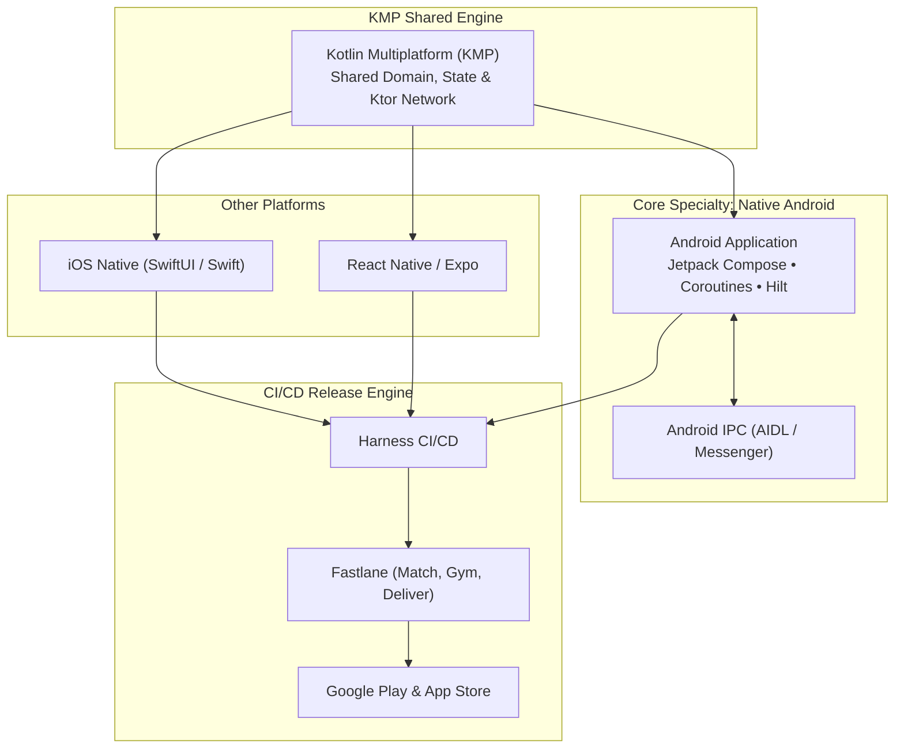

  <!-- Dynamic Header Banner -->
  

  <!-- Animated Typing SVG -->
  

   

  <!-- Social & Contact Badges -->
  

    
    
    
  

---

### 👨‍💻 About Me

I am a **Lead / Senior Native Android & Mobile Platform Engineer** with deep expertise in architecting high-performance, enterprise-grade mobile applications and continuous delivery infrastructure.

- 🤖 **Native Android (Core Focus)**: Extensive mastery of the Android ecosystem—**Kotlin**, **Java**, **Jetpack Compose**, **Coroutines & Flow**, **Dagger/Hilt**, Android Jetpack, IPC via **AIDL / Messenger**, and performance profiling.
- 🌐 **Kotlin Multiplatform (KMP)**: Pioneering shared business logic, reactive data layers, and networking (Ktor, SQLDelight) between Android and iOS without sacrificing native fidelity.
- ⚙️ **Enterprise CI/CD & Build Automation**: Architecting high-speed build and distribution pipelines using **Harness CI/CD** paired with **Fastlane** (match, gym, scan, deliver) for deterministic builds, automated signing, and zero-touch store deployments.
- 🍎 **Native iOS & Cross-Platform**: Building complementary native iOS experiences using **Swift**, **SwiftUI**, and Swift Package Manager, as well as React Native / Expo integration.
- 🎨 **Unified Design Systems & Architecture**: Staunch advocate of **Clean Architecture**, SOLID principles, unidirectional data flow (MVI/MVVM), and scalable component libraries.
- ⚛️ **React Native & Cross-Platform:** High-performance cross-platform mobile engineering—TypeScript, Expo, Fabric & TurboModules (New Architecture), Reanimated, Redux Toolkit / Zustand, Native Bridge modules, and Storybook design systems.

---

### 🛠️ Tech Stack & Skills

<table>
  <tr>
    <td align="center" width="170"><strong>Native Android</strong></td>
    <td>
      
      
      
      
      
      
      
      
    </td>
  </tr>
  <tr>
    <td align="center" width="170"><strong>Kotlin Multiplatform (KMP)</strong></td>
    <td>
      
      
      
      
    </td>
  </tr>
  <tr>
    <td align="center" width="170"><strong>CI/CD & DevOps</strong></td>
    <td>
      
      
      
      
      
      
    </td>
  </tr>
  <tr>
    <td align="center" width="170"><strong>Native iOS</strong></td>
    <td>
      
      
      
      
      
    </td>
  </tr>
  <tr>
    <td align="center" width="170"><strong>Cross-Platform & Web</strong></td>
    <td>
      
      
      
      
      
    </td>
  </tr>
  <tr>
    <td align="center" width="170"><strong>Architecture & Quality</strong></td>
    <td>
      
      
      
      
      
    </td>
  </tr>
</table>

---

### 🚀 Architecture & Delivery Workflow

---

### 📂 Highlighted Projects & Architecture Repositories

| Repository | Description | Key Tech |
| :--- | :--- | :--- |
| 🏛️ **[CleanArchitectureParseData](https://github.com/sangram2006/CleanArchitectureParseData)** | Demonstration of Clean Architecture principles separating Domain, Data, and Presentation layers for resilient data parsing. | Java, Android, Clean Architecture |
| ⚡ **[AIDLTest](https://github.com/sangram2006/AIDLTest)** | Deep-dive IPC (Inter-Process Communication) and Android Messenger implementation for background service isolation. | Java, AIDL, Android IPC |
| 🔌 **[aidl-example-master](https://github.com/sangram2006/aidl-example-master)** | Client-side Android application interfacing with remote background processes via AIDL services. | Java, Remote Services, AIDL |
| 🐦 **[TwitterClientSan](https://github.com/sangram2006/TwitterClientSan)** | Full-featured social client demonstration implementing REST APIs, custom timelines, and OAuth authentication. | Java, REST APIs, Mobile UI |
| 🛍️ **[Women](https://github.com/sangram2006/Women)** | Dynamic e-commerce and retail fashion exploration app focusing on product catalog navigation and fluid checkout UI. | Java, Android SDK, E-Commerce |

---

### 📊 GitHub Activity & Metrics

  
  &nbsp;
  

  

---

### 🤝 Let's Connect

  Whether you want to discuss Native Android architecture, Kotlin Multiplatform, mobile CI/CD with Harness and Fastlane, or design systems:

  
  
  

  Crafted with passion for Native Android excellence, clean architecture & automated delivery • Sangram Mohanty

